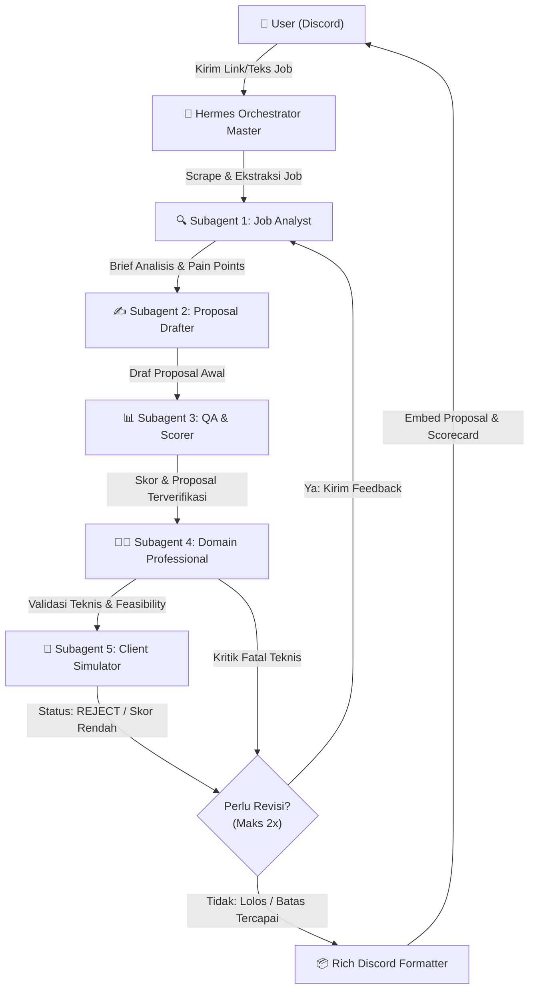
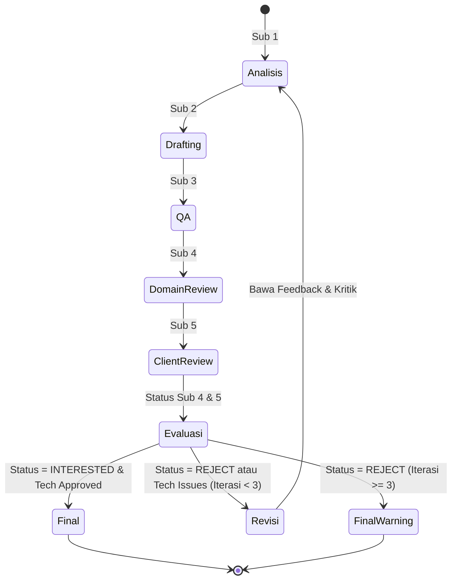

# Upwork Proposal Multi-Agent Orchestrator

SOP dan panduan orkestrasi untuk Hermes Agent sebagai konduktor utama dalam memproses link atau teks lowongan Upwork yang dikirim via Discord, mendelegasikannya ke 5 subagent spesialis secara sekuensial, mengelola loop revisi mandiri, dan mengembalikan proposal siap kirim lengkap dengan kartu skor evaluasi.

---

## 🏛️ Arsitektur Multi-Agent

Sistem ini mempekerjakan 5 subagent dengan pemisahan tanggung jawab yang tegas:



---

## 👥 Spesifikasi Peran Subagent

### 1. Master Orchestrator (Hermes)
- **Tanggung Jawab**:
  - Menerima event pesan Discord dari user.
  - Memanggil scraper untuk mengekstrak isi lowongan Upwork (judul, deskripsi, budget, kualifikasi, client history, screening questions).
  - Mengatur aliran data antar subagent dan mencatat log progres.
  - Menilai apakah kondisi revisi terpenuhi (berdasarkan status Subagent 4 & 5).
  - Membatasi perulangan maksimal 2x revisi (total 3 iterasi eksekusi).
  - Merender hasil akhir dalam bentuk Rich Embed Discord.

### 2. Subagent 1: Job Analyst (`prompts/sub1_job_analyst.md`)
- **Fungsi**: Membedah lowongan secara mendalam.
- **Output**:
  - *Core Problem*: Masalah utama yang ingin diselesaikan klien (eksplisit & implisit).
  - *Client Profile*: Gaya komunikasi, ekspektasi, dan tingkat kematangan teknis klien.
  - *Required Skills & Tech Stack*: Keahlian wajib vs nice-to-have.
  - *Screening Questions*: Daftar pertanyaan wajib yang diajukan klien (jika ada).
  - *Red Flags / Traps*: Hal-hal yang harus dihindari dalam proposal.

### 3. Subagent 2: Proposal Drafter (`prompts/sub2_proposal_drafter.md`)
- **Fungsi**: Menulis cover letter dan jawaban screening questions berdaya konversi tinggi.
- **Aturan Penulisan (Anti-Slop)**:
  - **Dilarang** membuka dengan salam klise: *"I hope this proposal finds you well"*, *"I am writing to express my enthusiastic interest"*, *"Dear Hiring Manager"*.
  - **Wajib** langsung menyentuh inti masalah di kalimat pertama (Hook Tajam).
  - Memberikan arsitektur solusi singkat dan realistis (Action Plan).
  - Menyertakan bukti relevan (Proof of Work) tanpa menyombongkan diri.
  - Call-to-Action (CTA) ramah dan berfokus pada diskusi teknis cepat (low friction).

### 4. Subagent 3: Proposal QA & Scorer (`prompts/sub3_qa_scorer.md`)
- **Fungsi**: Mengaudit draf proposal dan memberikan skor objektif 1–100.
- **Rubrik Penilaian**:
  1. *Hook & Relevance (Bobot 25%)*: Seberapa cepat proposal menarik perhatian dan relevan dengan pain point klien.
  2. *Actionability & Solution (Bobot 30%)*: Seberapa jelas dan masuk akal solusi yang ditawarkan.
  3. *Tone & Anti-AI Slop (Bobot 25%)*: Keaslian suara, tidak terdengar seperti template ChatGPT generik.
  4. *Completeness & Screening Answers (Bobot 20%)*: Apakah seluruh pertanyaan klien terjawab tuntas.
- **Ambang Batas**: Skor minimal **75/100** untuk diteruskan ke Subagent 4.

### 5. Subagent 4: Domain Professional (`prompts/sub4_domain_professional.md`)
- **Fungsi**: Mereview proposal dari kacamata Senior Practitioner di bidang terkait (misal Senior UI/UX Designer, Senior Fullstack Dev, DevOps Engineer, Data Specialist sesuai job domain).
- **Fokus Evaluasi**:
  - Ketepatan terminologi teknis.
  - Kelayakan estimasi waktu dan metodologi kerja.
  - Deteksi janji berlebihan (*over-promising*) yang mustahil dikerjakan.
- **Output Status**: `APPROVED` atau `NEEDS_REVISION` disertai catatan koreksi teknis.

### 6. Subagent 5: Job Owner / Client Simulator (`prompts/sub5_client_simulator.md`)
- **Fungsi**: Membaca proposal dari sudut pandang pemilik lowongan yang sibuk (menerima 50+ proposal per hari).
- **Fokus Evaluasi**:
  - Apakah proposal terasa personal atau copy-paste masal?
  - Apakah penulis memahami kebutuhan bisnis klien?
  - Apakah klien merasa nyaman untuk mengundang wawancara?
- **Output Keputusan**:
  - `INTERESTED` (Klien ingin mengundang wawancara / hire).
  - `REJECT` (Proposal dilewati / di-archive).

---

## 🔁 Protokol Loop Revisi



1. **Syarat Lolos**: Subagent 4 memberikan `APPROVED` dan Subagent 5 memberikan `INTERESTED`.
2. **Kondisi Revisi**:
   - Subagent 4 menemukan kekeliruan teknis fatal ATAU
   - Subagent 5 memberikan keputusan `REJECT`.
3. **Mekanisme Umpan Balik**:
   - Catatan kritik spesifik dari Sub 4 & Sub 5 dikirimkan kembali ke **Subagent 1** untuk merevisi brief analisa.
   - **Subagent 2** menyusun ulang proposal dengan fokus memperbaiki poin penolakan.
   - **Subagent 3, 4, dan 5** melakukan evaluasi ulang.
4. **Batas Maksimal**:
   - Maksimal 2x revisi (total 3 ronde pengerjaan).
   - Jika pada ronde ke-3 masih ditolak, orchestrator memfinalisasi draf dengan status **`WARNING: Max revisions reached`** dan menyertakan catatan evaluasi agar user dapat menyesuaikan secara manual.

---

## 🚫 Aturan Anti-Slop Upwork

Proposal yang dihasilkan oleh skill ini wajib mematuhi standar copywriting berikut:

| ❌ Dilarang Keras (AI Slop) | ✅ Wajib Digunakan (Human-Crafted) |
| :--- | :--- |
| "I am writing to submit my proposal for your project..." | "Saya melihat sistem autentikasi Anda mengalami kendala pada penanganan token session..." |
| "I have 5+ years of extensive experience delivering game-changing solutions..." | "Proyek terakhir saya menangani masalah serupa dengan arsitektur Redis caching dan memangkas latency hingga 40%." |
| "I will dive deep and leverage my skills..." | "Tiga langkah awal yang akan saya eksekusi di sprint pertama adalah: 1. ..., 2. ..., 3. ..." |
| "Let me know if you want to chat. Thanks!" | "Kapan waktu santai Anda minggu ini untuk quick sync 10 menit via Upwork Call?" |

---

## 🚀 Panduan Menjalankan Script

Untuk menjalankan integrasi bot Discord dan scraper Upwork secara lokal:

1. Buka direktori skrip:
   ```bash
   cd freelance-skill/upwork-proposal-orchestrator/scripts
   ```
2. Pasang dependensi:
   ```bash
   npm install
   ```
3. Salin file environment dan lengkapi kredensial:
   ```bash
   cp .env.example .env
   ```
4. Jalankan bot:
   ```bash
   npm start
   ```
5. Kirim link lowongan Upwork di channel Discord yang dapat diakses oleh bot:
   `https://www.upwork.com/jobs/~01abc123...`
